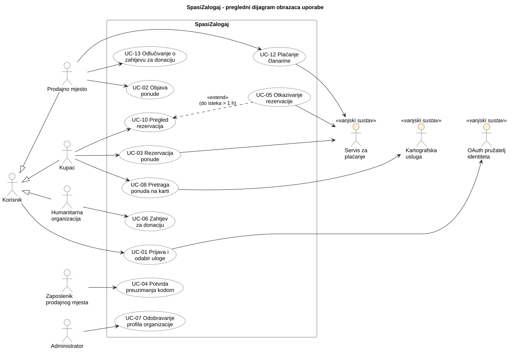
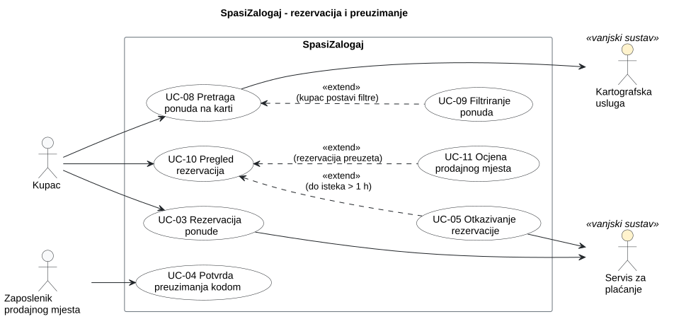

# 3. Obrasci uporabe

Obrasci uporabe opisuju glavne interakcije aktera sa sustavom SpasiZalogaj. Temelje se na funkcijskim zahtjevima iz [analize zahtjeva](2-Analiza-zahtjeva.md) (oznake F-xxx). Obrasci UC-01 do UC-13 pokrivaju osnovne funkcije sustava: prijavu, plaćanje članarine, objavu ponuda, pretragu i rezervaciju s plaćanjem, pregled, otkazivanje i preuzimanje rezervacija, ocjenjivanje, donacije i odobravanje profila. Svaki obrazac prikazan na dijagramima ima oznaku i specifikaciju u poglavlju 3.2.

## 3.1 Dijagram obrazaca uporabe

**Slika 3.1. Dijagram obrazaca uporabe sustava SpasiZalogaj**

**PlantUML izvor:** [izvor](./puml/3-1-spasizalogaj-system-UC.puml)

**Akteri:**
- **Korisnik** je opći akter za registrirane korisnike: kupac, prodajno mjesto i humanitarna organizacija nasljeđuju njegov osnovni obrazac uporabe (UC-01 Prijava i odabir uloge).
- **Kupac** pretražuje ponude na karti (UC-08), rezervira hranu s plaćanjem (UC-03), pregledava svoje rezervacije i kodove za preuzimanje (UC-10) te može otkazati rezervaciju najkasnije 1 h ranije (UC-05). Pri preuzimanju kupac samo pokazuje kod, a u sustavu ga potvrđuje zaposlenik (UC-04), pa kupac nije povezan s tim obrascem.
- **Prodajno mjesto** plaća članarinu (UC-12), objavljuje ponude (UC-02) te odlučuje o zaprimljenim zahtjevima za donaciju (UC-13).
- **Zaposlenik prodajnog mjesta** provjerava i potvrđuje preuzimanje kodom (UC-04).
- **Humanitarna organizacija** pregledava donacije i šalje zahtjeve za hranu (UC-06).
- **Administrator** odobrava profile organizacija (UC-07) i određuje cijene članarine.
- **Vanjski sustavi** (sekundarni akteri): OAuth pružatelj identiteta (UC-01), servis za plaćanje (UC-03, UC-05 i UC-12) te kartografska usluga (UC-08).

**Obrasci uporabe na dijagramu:**
- **UC-01 Prijava i odabir uloge:** korisnik se prijavljuje preko vanjskog OAuth pružatelja identiteta (npr. Google). Pri prvoj prijavi odabire ulogu (kupac, prodajno mjesto ili humanitarna organizacija) i unosi osnovne podatke profila. Profil humanitarne organizacije ostaje neaktivan dok ga administrator ne odobri (UC-07).
- **UC-02 Objava ponude:** prodajno mjesto objavljuje pojedinačni proizvod sa sniženom cijenom ili paket iznenađenja. Proizvod može označiti i kao donaciju, koju tada vide samo odobrene humanitarne organizacije. Objava je moguća samo uz aktivnu članarinu.
- **UC-03 Rezervacija ponude:** kupac odabire ponudu i količinu, potvrđuje rezervaciju i plaća je PayPalom ili karticom preko vanjskog servisa za plaćanje. Rezervacija nastaje tek nakon uspješnog plaćanja, a kupac dobiva jedinstveni kod za preuzimanje (tekst i QR).
- **UC-04 Potvrda preuzimanja kodom:** zaposlenik prodajnog mjesta skenira ili ručno unosi kod koji mu kupac pokaže. Sustav označava rezervaciju kao preuzetu i kod postaje nevažeći. S obrascem je povezan samo zaposlenik jer jedino on pritom radi u sustavu.
- **UC-05 Otkazivanje rezervacije:** opcionalno proširenje (`<<extend>>`) pregleda rezervacija (UC-10). Kupac otkazuje rezervaciju iz popisa svojih rezervacija ako je do kraja vremena preuzimanja ostalo više od jednog sata. Sustav vraća količinu u ponudu i preko servisa za plaćanje pokreće povrat novca.
- **UC-06 Zahtjev za donaciju:** odobrena humanitarna organizacija odabire ponudu označenu kao donacija i šalje zahtjev za određenu količinu. Zahtjev čeka odluku prodajnog mjesta (UC-13).
- **UC-07 Odobravanje profila organizacije:** administrator pregledava profil humanitarne organizacije i odobrava ga ili odbija uz razlog. Tek odobrena organizacija može vidjeti donacije i slati zahtjeve.
- **UC-08 Pretraga ponuda na karti:** kupac pregledava aktivne ponude na popisu i na karti koju prikazuje vanjska kartografska usluga te vidi udaljenost prodajnih mjesta od sebe.
- **UC-10 Pregled rezervacija:** kupac otvara popis svojih rezervacija sa statusom (aktivna, preuzeta, otkazana ili istekla) i kodom za preuzimanje. Iz tog popisa kupac može otkazati rezervaciju (UC-05).
- **UC-12 Plaćanje članarine:** prodajno mjesto plaća mjesečnu ili godišnju članarinu PayPalom ili karticom preko vanjskog servisa za plaćanje. Nakon uspješnog plaćanja članarina je aktivna do datuma isteka.
- **UC-13 Odlučivanje o zahtjevu za donaciju:** prodajno mjesto koje je objavilo donaciju odobrava ili odbija zahtjev humanitarne organizacije. Odobrena količina rezervira se za organizaciju, a organizacija dobiva obavijest o odluci.

Detaljniji prikaz kupčevih obrazaca nalazi se na slici 3.2. Redoslijed obrazaca uporabe (npr. aktivna članarina prije objave ponude) ne prikazuje se vezom na dijagramu, nego je naveden u preduvjetima specifikacije obrasca (poglavlje 3.2).

### 3.1.1 Rezervacija i preuzimanje

**Slika 3.2. Dijagram obrazaca uporabe za rezervaciju i preuzimanje**

**PlantUML izvor:** [izvor](./puml/3-2-spasizalogaj-reservation-UC.puml)

Dijagram prikazuje obrasce uporabe kupca od pronalaska ponude do preuzimanja hrane:
- **UC-08 Pretraga ponuda na karti:** kupac pregledava aktivne ponude na popisu i na karti koju prikazuje vanjska kartografska usluga.
- **UC-09 Filtriranje ponuda:** opcionalno proširenje (`<<extend>>`) pretrage. Kada kupac postavi filtre (kategorija, udaljenost, cijena, vrijeme preuzimanja), sustav prikazuje samo odgovarajuće ponude.
- **UC-03 Rezervacija ponude:** kupac odabire ponudu i količinu te plaća preko vanjskog servisa za plaćanje. Rezervacija se stvara tek nakon što servis potvrdi uplatu.
- **UC-10 Pregled rezervacija:** kupac otvara popis svojih rezervacija sa statusom i kodom za preuzimanje.
- **UC-05 Otkazivanje rezervacije:** opcionalno proširenje (`<<extend>>`) pregleda rezervacija, moguće samo ako je do isteka vremena preuzimanja ostalo više od jednog sata. Povrat novca izvodi servis za plaćanje.
- **UC-11 Ocjena prodajnog mjesta:** opcionalno proširenje (`<<extend>>`) pregleda rezervacija, moguće nakon što je rezervacija preuzeta.
- **UC-04 Potvrda preuzimanja kodom:** zaposlenik prodajnog mjesta skenira ili unosi kod koji kupac pokaže i potvrđuje preuzimanje. Kupac kod dobiva pri rezervaciji (UC-03) i vidi ga u pregledu rezervacija (UC-10), pa nije povezan s UC-04.

## 3.2 Specifikacije obrazaca uporabe

### UC-01: Prijava i odabir uloge

| Element specifikacije | Opis |
| :--- | :--- |
| **Primarni akter** | Kupac, prodajno mjesto ili humanitarna organizacija (neprijavljeni korisnik) |
| **Sekundarni akter** | OAuth pružatelj identiteta |
| **Povezani zahtjevi** | F-001, F-002 |
| **Preduvjeti** | Korisnik ima račun kod podržanog vanjskog pružatelja identiteta. |
| **Glavni uspješni tok** | 1. Korisnik odabire „Prijava”. 2. Sustav preusmjerava korisnika na vanjskog pružatelja identiteta. 3. Korisnik se prijavljuje kod pružatelja i dopušta dijeljenje osnovnih podataka (ime, e-pošta). 4. Pružatelj vraća korisnika u sustav s potvrdom identiteta. 5. Sustav utvrđuje da je riječ o novom korisniku i traži odabir uloge: kupac, prodajno mjesto ili humanitarna organizacija. 6. Korisnik odabire ulogu i unosi osnovne podatke profila. 7. Sustav sprema korisnika i prikazuje početnu stranicu za odabranu ulogu. |
| **Alternativni tokovi / Iznimke** | **3a — Korisnik odustane ili pružatelj odbije prijavu:** sustav prikazuje poruku da prijava nije uspjela i korisnik ostaje neprijavljen. **4a — Pružatelj identiteta nije dostupan:** sustav prikazuje poruku o privremenoj nedostupnosti prijave; ostale javne stranice i dalje rade. **5a — Korisnik već postoji:** sustav preskače odabir uloge i prikazuje početnu stranicu prema postojećoj ulozi. **6a — Odabrana uloga je humanitarna organizacija:** profil se sprema kao neaktivan i čeka odobrenje administratora (UC-07); korisnik vidi obavijest da profil čeka odobrenje. |
| **Posljedice (ishod)** | Korisnik je prijavljen i ima dodijeljenu ulogu; profil humanitarne organizacije čeka odobrenje. |

### UC-02: Objava ponude

| Element specifikacije | Opis |
| :--- | :--- |
| **Primarni akter** | Prodajno mjesto |
| **Povezani zahtjevi** | F-006, F-007 |
| **Preduvjeti** | Prodajno mjesto je prijavljeno i ima aktivnu članarinu (UC-12). |
| **Glavni uspješni tok** | 1. Prodajno mjesto odabire „Nova ponuda”. 2. Sustav nudi izbor: pojedinačni proizvod ili paket iznenađenja. 3. Prodajno mjesto odabire pojedinačni proizvod i unosi naziv, kategoriju, količinu, redovnu cijenu, sniženu cijenu, rok upotrebe, krajnje vrijeme preuzimanja i po želji fotografiju. 4. Sustav provjerava obavezna polja i vrijednosti (npr. snižena cijena manja od redovne, vrijeme preuzimanja u budućnosti). 5. Sustav sprema ponudu i prikazuje je na javnom profilu prodajnog mjesta i u pretrazi. |
| **Alternativni tokovi / Iznimke** | **1a — Članarina nije aktivna:** sustav ne dopušta objavu i upućuje na plaćanje članarine (UC-12). **2a — Paket iznenađenja:** prodajno mjesto unosi približnu vrstu sadržaja, ukupnu vrijednost, prodajnu cijenu, broj paketa i interval preuzimanja; tok se nastavlja u koraku 4. Kupci vide broj dostupnih paketa, ali ne i točan sadržaj. **3a — Proizvod se donira:** prodajno mjesto umjesto snižene cijene označava „donacija”; takvu ponudu vide samo odobrene humanitarne organizacije, koje za nju mogu poslati zahtjev (UC-06). **4a — Neispravni podaci:** sustav označava neispravna polja, zadržava unesene podatke i ne sprema ponudu dok se podaci ne isprave. |
| **Posljedice (ishod)** | Nova ponuda je vidljiva kupcima (donacija samo odobrenim humanitarnim organizacijama) do isteka vremena preuzimanja ili dok se količina ne potroši. |

### UC-03: Rezervacija ponude

| Element specifikacije | Opis |
| :--- | :--- |
| **Primarni akter** | Kupac |
| **Sekundarni akter** | Servis za plaćanje |
| **Povezani zahtjevi** | F-010 |
| **Preduvjeti** | Kupac je prijavljen i odabrao je aktivnu ponudu (npr. kroz pretragu, UC-08). |
| **Glavni uspješni tok** | 1. Kupac otvara detalje ponude i odabire količinu. 2. Kupac potvrđuje rezervaciju i odabire način plaćanja (PayPal ili kartica). 3. Sustav preusmjerava kupca na vanjski servis za plaćanje; kupac plaća. 4. Servis za plaćanje potvrđuje uspješno plaćanje. 5. Sustav smanjuje dostupnu količinu, sprema rezervaciju i prikazuje potvrdu s jedinstvenim kodom za preuzimanje (tekst i QR). |
| **Alternativni tokovi / Iznimke** | **2a — Količina više nije dostupna:** sustav javlja da je ponuda u međuvremenu rezervirana ili da je dostupna manja količina; rezervacija se ne stvara. **3a — Plaćanje nije uspjelo ili je kupac odustao:** sustav ne stvara rezervaciju, količina ostaje dostupna i kupac može pokušati ponovno. |
| **Posljedice (ishod)** | Postoji plaćena rezervacija s jedinstvenim kodom, a dostupna količina ponude je umanjena. |

### UC-04: Potvrda preuzimanja kodom

| Element specifikacije | Opis |
| :--- | :--- |
| **Primarni akter** | Zaposlenik prodajnog mjesta |
| **Povezani zahtjevi** | F-012 |
| **Preduvjeti** | Zaposlenik je prijavljen u ime prodajnog mjesta. Kupac ima rezervaciju za to prodajno mjesto. |
| **Glavni uspješni tok** | 1. Kupac dolazi u prodajno mjesto i pokazuje kod (tekst ili QR). 2. Zaposlenik otvara „Potvrda preuzimanja” i skenira QR kod ili ručno unosi kod. 3. Sustav pronalazi rezervaciju i prikazuje stavke i količine. 4. Zaposlenik predaje hranu i potvrđuje preuzimanje. 5. Sustav označava rezervaciju kao preuzetu i kod postaje nevažeći. |
| **Alternativni tokovi / Iznimke** | **2a — Kamera nije dostupna:** zaposlenik ručno unosi kod; tok se nastavlja u koraku 3. **3a — Kod ne postoji ili pripada drugom prodajnom mjestu:** sustav javlja da kod nije valjan i ništa se ne mijenja. **3b — Rezervacija je već preuzeta ili otkazana:** sustav prikazuje status rezervacije i ne dopušta ponovno preuzimanje. **3c — Vrijeme preuzimanja je isteklo:** sustav prikazuje da je rezervacija istekla; postupak u tom slučaju ovisi o pravilima prodajnog mjesta (otvoreno pitanje P-05 uz F-012). |
| **Posljedice (ishod)** | Rezervacija je označena kao preuzeta; kupac može ocijeniti prodajno mjesto (F-014). |

### UC-05: Otkazivanje rezervacije

| Element specifikacije | Opis |
| :--- | :--- |
| **Primarni akter** | Kupac |
| **Sekundarni akter** | Servis za plaćanje |
| **Povezani zahtjevi** | F-011, F-013 |
| **Preduvjeti** | Kupac je prijavljen i ima aktivnu (nepreuzetu) rezervaciju. |
| **Glavni uspješni tok** | 1. Kupac otvara popis svojih rezervacija (UC-10). 2. Kupac odabire rezervaciju i odabire „Otkaži”. 3. Sustav provjerava da je do isteka vremena preuzimanja ostalo više od jednog sata. 4. Sustav traži potvrdu otkazivanja. 5. Kupac potvrđuje. 6. Sustav označava rezervaciju kao otkazanu, vraća količinu u ponudu i pokreće povrat novca preko servisa za plaćanje. |
| **Alternativni tokovi / Iznimke** | **3a — Do isteka je ostalo manje od jednog sata:** sustav ne dopušta otkazivanje i objašnjava razlog. **5a — Kupac odustane:** rezervacija ostaje aktivna. **6a — Povrat novca nije uspio:** rezervacija je otkazana, a povrat se bilježi za ponovni pokušaj; kupac dobiva obavijest. |
| **Posljedice (ishod)** | Rezervacija je otkazana, količina je ponovno dostupna, a kupcu je pokrenut povrat novca. |

### UC-06: Zahtjev za donaciju

| Element specifikacije | Opis |
| :--- | :--- |
| **Primarni akter** | Humanitarna organizacija |
| **Povezani zahtjevi** | F-006, F-015 |
| **Preduvjeti** | Profil humanitarne organizacije je odobren (UC-07). Postoji donacijska ponuda (UC-02). |
| **Glavni uspješni tok** | 1. Humanitarna organizacija otvara popis donacijskih ponuda. 2. Organizacija odabire ponudu i unosi traženu količinu. 3. Sustav sprema zahtjev sa statusom „na čekanju” i obavještava prodajno mjesto koje je objavilo donaciju. |
| **Alternativni tokovi / Iznimke** | **1a — Profil organizacije nije odobren:** sustav ne prikazuje donacijske ponude i upućuje na čekanje odobrenja (UC-07). **2a — Tražena količina veća je od dostupne:** sustav javlja dostupnu količinu i ne sprema zahtjev. |
| **Posljedice (ishod)** | Zahtjev je spremljen sa statusom „na čekanju”; o njemu odlučuje prodajno mjesto (UC-13). |

### UC-07: Odobravanje profila organizacije

| Element specifikacije | Opis |
| :--- | :--- |
| **Primarni akter** | Administrator |
| **Povezani zahtjevi** | F-002 |
| **Preduvjeti** | Administrator je prijavljen. Postoji barem jedan profil koji čeka odobrenje. |
| **Glavni uspješni tok** | 1. Administrator otvara popis profila koji čekaju odobrenje. 2. Administrator otvara profil i pregledava podatke (naziv, kontakt, područje djelovanja). 3. Administrator odobrava profil. 4. Sustav aktivira profil i obavještava korisnika. |
| **Alternativni tokovi / Iznimke** | **3a — Administrator odbija profil:** unosi razlog odbijanja; sustav profil označava kao odbijen i obavještava korisnika s razlogom. **3b — Nedostaju podaci:** administrator traži dopunu; profil ostaje na čekanju. |
| **Posljedice (ishod)** | Profil je aktivan i organizacija može koristiti donacijske funkcionalnosti, ili je odbijen uz razlog. Koje uloge osim humanitarnih organizacija trebaju odobrenje otvoreno je pitanje (P-08 uz F-002). |

### UC-08: Pretraga ponuda na karti

| Element specifikacije | Opis |
| :--- | :--- |
| **Primarni akter** | Kupac |
| **Sekundarni akter** | Kartografska usluga |
| **Povezani zahtjevi** | F-009 |
| **Preduvjeti** | Kupac je prijavljen. |
| **Glavni uspješni tok** | 1. Kupac otvara pretragu; sustav prikazuje popis aktivnih ponuda i kartu s prodajnim mjestima. 2. Kupac dopušta pristup lokaciji; sustav prikazuje udaljenost prodajnih mjesta. 3. Kupac odabire ponudu na popisu ili prodajno mjesto na karti. 4. Sustav prikazuje detalje ponude (cijena, količina, vrijeme preuzimanja, adresa). |
| **Alternativni tokovi / Iznimke** | **1a — Kartografska usluga nije dostupna:** sustav prikazuje samo popis ponuda s adresama i poruku da karta trenutno nije dostupna. **1b — Nema aktivnih ponuda:** sustav prikazuje poruku da trenutno nema ponuda. **2a — Kupac ne dopušta lokaciju:** sustav prikazuje kartu bez udaljenosti, a kupac može ručno upisati adresu ili pomaknuti kartu. **3a — Kupac želi suziti rezultate:** kupac postavlja filtre (UC-09); tok se nastavlja u koraku 3. |
| **Posljedice (ishod)** | Kupac vidi aktivne ponude i može odabrati jednu za rezervaciju (UC-03). |

### UC-09: Filtriranje ponuda

| Element specifikacije | Opis |
| :--- | :--- |
| **Primarni akter** | Kupac |
| **Povezani zahtjevi** | F-009 |
| **Preduvjeti** | Kupac je u pretrazi ponuda (UC-08). |
| **Glavni uspješni tok** | 1. Kupac otvara filtre. 2. Kupac postavlja jedan ili više filtara: kategoriju hrane, najveću udaljenost, raspon cijene i vrijeme preuzimanja. 3. Sustav na popisu i na karti prikazuje samo ponude koje zadovoljavaju sve postavljene filtre. |
| **Alternativni tokovi / Iznimke** | **3a — Nema ponuda za odabrane filtre:** sustav prikazuje poruku i nudi uklanjanje filtara. **3b — Kupac uklanja filtre:** sustav ponovno prikazuje sve aktivne ponude. |
| **Posljedice (ishod)** | Popis i karta prikazuju samo ponude koje odgovaraju kupčevim filtrima. |

### UC-10: Pregled rezervacija

| Element specifikacije | Opis |
| :--- | :--- |
| **Primarni akter** | Kupac |
| **Povezani zahtjevi** | F-013 |
| **Preduvjeti** | Kupac je prijavljen. |
| **Glavni uspješni tok** | 1. Kupac otvara „Moje rezervacije”. 2. Sustav prikazuje popis rezervacija s prodajnim mjestom, stavkama, vremenom preuzimanja i statusom (aktivna, preuzeta, otkazana ili istekla). 3. Kupac otvara rezervaciju; sustav prikazuje njezine detalje i kod za preuzimanje. |
| **Alternativni tokovi / Iznimke** | **2a — Kupac nema rezervacija:** sustav prikazuje poruku i poveznicu na pretragu ponuda (UC-08). **3a — Rezervacija je aktivna i do isteka je ostalo više od jednog sata:** kupac može otkazati rezervaciju (UC-05). **3b — Rezervacija je preuzeta i nije ocijenjena:** kupac može ocijeniti prodajno mjesto (UC-11). |
| **Posljedice (ishod)** | Kupac vidi stanje svojih rezervacija i kodove za preuzimanje. |

### UC-11: Ocjena prodajnog mjesta

| Element specifikacije | Opis |
| :--- | :--- |
| **Primarni akter** | Kupac |
| **Povezani zahtjevi** | F-014 |
| **Preduvjeti** | Kupac ima preuzetu rezervaciju (UC-04) koju još nije ocijenio. |
| **Glavni uspješni tok** | 1. Kupac u pregledu rezervacija (UC-10) odabire preuzetu rezervaciju i „Ocijeni”. 2. Kupac odabire ocjenu i po želji upisuje komentar. 3. Sustav sprema ocjenu i prikazuje je na javnom profilu prodajnog mjesta. |
| **Alternativni tokovi / Iznimke** | **2a — Kupac nije odabrao ocjenu:** sustav ne sprema ocjenu i traži odabir. **2b — Kupac odustane:** ništa se ne sprema; rezervaciju može ocijeniti kasnije. |
| **Posljedice (ishod)** | Ocjena i komentar vidljivi su na javnom profilu prodajnog mjesta, a prodajno mjesto može odgovoriti na komentar. |

### UC-12: Plaćanje članarine

| Element specifikacije | Opis |
| :--- | :--- |
| **Primarni akter** | Prodajno mjesto |
| **Sekundarni akter** | Servis za plaćanje |
| **Povezani zahtjevi** | F-005 |
| **Preduvjeti** | Prodajno mjesto je prijavljeno. |
| **Glavni uspješni tok** | 1. Prodajno mjesto otvara „Članarina”. 2. Sustav prikazuje mjesečnu i godišnju članarinu s cijenama koje je odredio administrator. 3. Prodajno mjesto odabire vrstu članarine i način plaćanja (PayPal ili kartica). 4. Sustav preusmjerava prodajno mjesto na vanjski servis za plaćanje; prodajno mjesto plaća. 5. Servis za plaćanje potvrđuje uspješno plaćanje. 6. Sustav aktivira članarinu do datuma isteka i omogućuje objavu ponuda (UC-02). |
| **Alternativni tokovi / Iznimke** | **4a — Plaćanje nije uspjelo ili je prodajno mjesto odustalo:** članarina se ne aktivira i prodajno mjesto može pokušati ponovno. |
| **Posljedice (ishod)** | Članarina je aktivna do datuma isteka. Što se po isteku događa s već objavljenim ponudama otvoreno je pitanje (P-01 uz F-005). |

### UC-13: Odlučivanje o zahtjevu za donaciju

| Element specifikacije | Opis |
| :--- | :--- |
| **Primarni akter** | Prodajno mjesto |
| **Ostali akteri** | Humanitarna organizacija (prima obavijest o odluci) |
| **Povezani zahtjevi** | F-016 |
| **Preduvjeti** | Postoji zahtjev za donaciju sa statusom „na čekanju” za donaciju tog prodajnog mjesta (UC-06). |
| **Glavni uspješni tok** | 1. Prodajno mjesto otvara obavijest ili popis zahtjeva za donaciju. 2. Sustav prikazuje organizaciju, doniranu ponudu i traženu količinu. 3. Prodajno mjesto odobrava zahtjev. 4. Sustav rezervira odobrenu količinu za organizaciju, mijenja status zahtjeva u „odobren” i obavještava organizaciju. |
| **Alternativni tokovi / Iznimke** | **3a — Prodajno mjesto odbija zahtjev:** sustav mijenja status u „odbijen”, količina ostaje dostupna, a organizacija dobiva obavijest. **3b — Ponuda istekne prije odluke:** zahtjev se automatski zatvara kao neostvaren. |
| **Posljedice (ishod)** | Zahtjev je odobren ili odbijen; odobrena količina rezervirana je za organizaciju. Način potvrde preuzimanja donacije otvoreno je pitanje (P-06 uz F-016). |

## 3.3 Provjera dosljednosti obrazaca uporabe

| Provjera | Stanje |
| --- | --- |
| Zahtjev | Svaki obrazac UC-01 do UC-13 povezan je s postojećim funkcijskim zahtjevima iz [analize zahtjeva](2-Analiza-zahtjeva.md). Cjelovita veza zahtjev → obrazac uporabe → ispitivanje održava se u [tablici sljedivosti](2-Analiza-zahtjeva.md#26-sljedivost-zahtjeva). |
| Akter | Akteri odgovaraju ulogama iz zadatka: kupac, prodajno mjesto (i zaposlenik), humanitarna organizacija, administrator te vanjski sustavi kao sekundarni akteri. |
| Otvorena pitanja | Ponašanje koje ovisi o otvorenim pitanjima (F-005 članarina, F-011 računanje roka otkazivanja, F-012 nepreuzete rezervacije, F-016 potvrda preuzimanja donacije, F-002 koje uloge traže odobrenje) označeno je u alternativnim tokovima i bit će usklađeno nakon dogovora s asistenticom. |
| Aplikacija | Opisani tokovi predstavljaju trenutačno oblikovanje; implementacija još nije započeta. |
