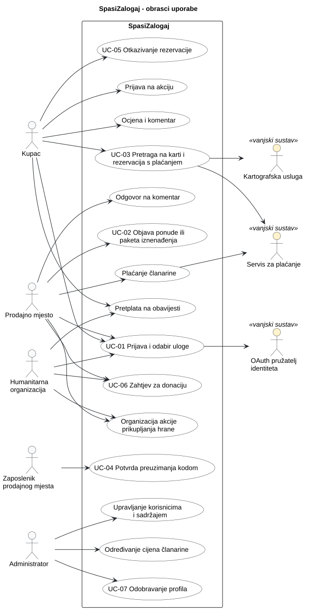

# 3. Obrasci uporabe

Obrasci uporabe opisuju glavne interakcije aktera sa sustavom SpasiZalogaj. Temelje se na funkcijskim zahtjevima iz [analize zahtjeva](2-Analiza-zahtjeva.md) (oznake FZ-xx). Ključni obrasci (UC-01 do UC-07) pokrivaju osnovni tok sustava: prijavu, objavu ponude, rezervaciju, preuzimanje, otkazivanje, donacije i odobravanje profila. Ostali obrasci prikazani su na dijagramu i bit će detaljnije razrađeni u sljedećim iteracijama.

## 3.1 Dijagram obrazaca uporabe

**Slika 3.1. Dijagram obrazaca uporabe sustava SpasiZalogaj**

**PlantUML izvor:** [izvor](./puml/3-1-spasizalogaj-system-UC.puml)

**Akteri:**
- **Korisnik** je opći akter za registrirane korisnike: kupac, prodajno mjesto i humanitarna organizacija nasljeđuju njegove obrasce uporabe (prijava i odabir uloge, pretplata na obavijesti).
- **Kupac** pretražuje, rezervira, plaća, otkazuje i ocjenjuje.
- **Prodajno mjesto** objavljuje ponude, plaća članarinu i odlučuje o zahtjevima za donaciju.
- **Zaposlenik prodajnog mjesta** potvrđuje preuzimanje kodom.
- **Humanitarna organizacija** pregledava donacijske ponude i šalje zahtjeve.
- **Administrator** odobrava profile, određuje cijene članarine i upravlja sadržajem.
- **Vanjski sustavi** (sekundarni akteri): OAuth pružatelj identiteta (prijava), servis za plaćanje (rezervacije i članarine), kartografska usluga (prikaz lokacija i udaljenosti).

## 3.2 Specifikacije obrazaca uporabe

### UC-01: Prijava i odabir uloge

| Element specifikacije | Opis |
| :--- | :--- |
| **Primarni akter** | Kupac, prodajno mjesto ili humanitarna organizacija (neprijavljeni korisnik) |
| **Sekundarni akter** | OAuth pružatelj identiteta |
| **Povezani zahtjevi** | FZ-01, FZ-02, FZ-03 |
| **Preduvjeti** | Korisnik ima račun kod podržanog vanjskog pružatelja identiteta. |
| **Glavni uspješni tok** | 1. Korisnik odabire „Prijava”. 2. Sustav preusmjerava korisnika na vanjskog pružatelja identiteta. 3. Korisnik se prijavljuje kod pružatelja i dopušta dijeljenje osnovnih podataka (ime, e-pošta). 4. Pružatelj vraća korisnika u sustav s potvrdom identiteta. 5. Sustav utvrđuje da je riječ o novom korisniku i traži odabir uloge: kupac, prodajno mjesto ili humanitarna organizacija. 6. Korisnik odabire ulogu i unosi osnovne podatke profila. 7. Sustav sprema korisnika i prikazuje početnu stranicu za odabranu ulogu. |
| **Alternativni tokovi / Iznimke** | **3a — Korisnik odustane ili pružatelj odbije prijavu:** sustav prikazuje poruku da prijava nije uspjela i korisnik ostaje neprijavljen. **4a — Pružatelj identiteta nije dostupan:** sustav prikazuje poruku o privremenoj nedostupnosti prijave; ostale javne stranice i dalje rade. **5a — Korisnik već postoji:** sustav preskače odabir uloge i prikazuje početnu stranicu prema postojećoj ulozi. **6a — Odabrana uloga je humanitarna organizacija:** profil se sprema kao neaktivan i čeka odobrenje administratora (UC-07); korisnik vidi obavijest da profil čeka odobrenje. |
| **Posljedice (ishod)** | Korisnik je prijavljen i ima dodijeljenu ulogu; profil humanitarne organizacije čeka odobrenje. |

### UC-02: Objava ponude ili paketa iznenađenja

| Element specifikacije | Opis |
| :--- | :--- |
| **Primarni akter** | Prodajno mjesto |
| **Povezani zahtjevi** | FZ-04, FZ-12, FZ-13, FZ-14 |
| **Preduvjeti** | Prodajno mjesto je prijavljeno i ima aktivnu članarinu. |
| **Glavni uspješni tok** | 1. Prodajno mjesto odabire „Nova ponuda”. 2. Sustav nudi izbor: pojedinačni proizvod ili paket iznenađenja. 3. Prodajno mjesto odabire pojedinačni proizvod i unosi naziv, kategoriju, količinu, redovnu cijenu, sniženu cijenu, rok upotrebe, krajnje vrijeme preuzimanja i po želji fotografiju. 4. Sustav provjerava obavezna polja i vrijednosti (npr. snižena cijena manja od redovne, vrijeme preuzimanja u budućnosti). 5. Sustav sprema ponudu i prikazuje je na javnom profilu prodajnog mjesta i u pretrazi. |
| **Alternativni tokovi / Iznimke** | **1a — Članarina nije aktivna:** sustav ne dopušta objavu i upućuje na plaćanje članarine. **2a — Paket iznenađenja:** prodajno mjesto unosi približnu vrstu sadržaja, ukupnu vrijednost, prodajnu cijenu, broj paketa i interval preuzimanja; tok se nastavlja u koraku 4. **3a — Proizvod se donira:** prodajno mjesto umjesto snižene cijene označava „donacija” i može odabrati „samo za humanitarne organizacije”; takvu ponudu vide samo humanitarne organizacije (UC-06). **4a — Neispravni podaci:** sustav označava neispravna polja, zadržava unesene podatke i ne sprema ponudu dok se podaci ne isprave. |
| **Posljedice (ishod)** | Nova ponuda je vidljiva kupcima (ili samo humanitarnim organizacijama) do isteka vremena preuzimanja ili dok se količina ne potroši. |

### UC-03: Pretraga na karti i rezervacija s plaćanjem

| Element specifikacije | Opis |
| :--- | :--- |
| **Primarni akter** | Kupac |
| **Sekundarni akteri** | Kartografska usluga, servis za plaćanje |
| **Povezani zahtjevi** | FZ-17, FZ-18, FZ-19, FZ-20, FZ-21, FZ-22 |
| **Preduvjeti** | Kupac je prijavljen. Postoji barem jedna aktivna ponuda. |
| **Glavni uspješni tok** | 1. Kupac otvara pretragu; sustav prikazuje popis aktivnih ponuda i kartu s prodajnim mjestima. 2. Kupac dopušta pristup lokaciji; sustav prikazuje udaljenost prodajnih mjesta. 3. Kupac filtrira ponude prema kategoriji, udaljenosti, cijeni i vremenu preuzimanja. 4. Kupac otvara detalje ponude i odabire količinu. 5. Kupac potvrđuje rezervaciju i odabire način plaćanja (PayPal ili kartica). 6. Sustav preusmjerava kupca na vanjski servis za plaćanje; kupac plaća. 7. Servis za plaćanje potvrđuje uspješno plaćanje. 8. Sustav smanjuje dostupnu količinu, sprema rezervaciju i prikazuje potvrdu s jedinstvenim kodom za preuzimanje (tekst i QR). |
| **Alternativni tokovi / Iznimke** | **1a — Kartografska usluga nije dostupna:** sustav prikazuje samo popis ponuda s adresama i poruku da karta trenutno nije dostupna. **2a — Kupac ne dopušta lokaciju:** sustav prikazuje kartu bez udaljenosti, a kupac može ručno upisati adresu ili pomaknuti kartu. **3a — Nema ponuda za odabrane filtre:** sustav prikazuje poruku i nudi uklanjanje filtara. **5a — Količina više nije dostupna:** sustav javlja da je ponuda u međuvremenu rezervirana ili da je dostupna manja količina; rezervacija se ne stvara. **6a — Plaćanje nije uspjelo ili je kupac odustao:** sustav ne stvara rezervaciju, količina ostaje dostupna i kupac može pokušati ponovno. |
| **Posljedice (ishod)** | Postoji plaćena rezervacija s jedinstvenim kodom, a dostupna količina ponude je umanjena. |

### UC-04: Potvrda preuzimanja kodom

| Element specifikacije | Opis |
| :--- | :--- |
| **Primarni akter** | Zaposlenik prodajnog mjesta |
| **Povezani zahtjevi** | FZ-24 |
| **Preduvjeti** | Zaposlenik je prijavljen u ime prodajnog mjesta. Kupac ima rezervaciju za to prodajno mjesto. |
| **Glavni uspješni tok** | 1. Kupac dolazi u prodajno mjesto i pokazuje kod (tekst ili QR). 2. Zaposlenik otvara „Potvrda preuzimanja” i skenira QR kod ili ručno unosi kod. 3. Sustav pronalazi rezervaciju i prikazuje stavke i količine. 4. Zaposlenik predaje hranu i potvrđuje preuzimanje. 5. Sustav označava rezervaciju kao preuzetu i kod postaje nevažeći. |
| **Alternativni tokovi / Iznimke** | **2a — Kamera nije dostupna:** zaposlenik ručno unosi kod; tok se nastavlja u koraku 3. **3a — Kod ne postoji ili pripada drugom prodajnom mjestu:** sustav javlja da kod nije valjan i ništa se ne mijenja. **3b — Rezervacija je već preuzeta ili otkazana:** sustav prikazuje status rezervacije i ne dopušta ponovno preuzimanje. **3c — Vrijeme preuzimanja je isteklo:** sustav prikazuje da je rezervacija istekla; postupak u tom slučaju ovisi o pravilima prodajnog mjesta (otvoreno pitanje uz FZ-27). |
| **Posljedice (ishod)** | Rezervacija je označena kao preuzeta; kupac može ocijeniti prodajno mjesto (FZ-28). |

### UC-05: Otkazivanje rezervacije

| Element specifikacije | Opis |
| :--- | :--- |
| **Primarni akter** | Kupac |
| **Sekundarni akter** | Servis za plaćanje |
| **Povezani zahtjevi** | FZ-23, FZ-25 |
| **Preduvjeti** | Kupac je prijavljen i ima aktivnu (nepreuzetu) rezervaciju. |
| **Glavni uspješni tok** | 1. Kupac otvara popis svojih rezervacija. 2. Kupac odabire rezervaciju i odabire „Otkaži”. 3. Sustav provjerava da je do isteka vremena preuzimanja ostalo više od jednog sata. 4. Sustav traži potvrdu otkazivanja. 5. Kupac potvrđuje. 6. Sustav označava rezervaciju kao otkazanu, vraća količinu u ponudu i pokreće povrat novca preko servisa za plaćanje. |
| **Alternativni tokovi / Iznimke** | **3a — Do isteka je ostalo manje od jednog sata:** sustav ne dopušta otkazivanje i objašnjava razlog. **5a — Kupac odustane:** rezervacija ostaje aktivna. **6a — Povrat novca nije uspio:** rezervacija je otkazana, a povrat se bilježi za ponovni pokušaj; kupac dobiva obavijest. |
| **Posljedice (ishod)** | Rezervacija je otkazana, količina je ponovno dostupna, a kupcu je pokrenut povrat novca. |

### UC-06: Zahtjev humanitarne organizacije za donaciju

| Element specifikacije | Opis |
| :--- | :--- |
| **Primarni akter** | Humanitarna organizacija |
| **Ostali akteri** | Prodajno mjesto (odobrava ili odbija zahtjev) |
| **Povezani zahtjevi** | FZ-14, FZ-30, FZ-31, FZ-32, FZ-33 |
| **Preduvjeti** | Profil humanitarne organizacije je odobren (aktivan). Postoji donacijska ponuda. |
| **Glavni uspješni tok** | 1. Humanitarna organizacija otvara popis donacijskih ponuda. 2. Organizacija odabire ponudu i unosi traženu količinu. 3. Sustav sprema zahtjev sa statusom „na čekanju” i obavještava prodajno mjesto. 4. Prodajno mjesto otvara zahtjev i odobrava ga. 5. Sustav rezervira odobrenu količinu, mijenja status zahtjeva u „odobren” i obavještava organizaciju. |
| **Alternativni tokovi / Iznimke** | **1a — Profil organizacije nije odobren:** sustav ne prikazuje donacijske ponude i upućuje na čekanje odobrenja (UC-07). **2a — Tražena količina veća je od dostupne:** sustav javlja dostupnu količinu i ne sprema zahtjev. **4a — Prodajno mjesto odbija zahtjev:** sustav mijenja status u „odbijen”, količina ostaje dostupna, a organizacija dobiva obavijest. **4b — Ponuda istekne prije odluke:** zahtjev se automatski zatvara kao neostvaren. |
| **Posljedice (ishod)** | Zahtjev je odobren ili odbijen; odobrena količina rezervirana je za organizaciju. Način potvrde preuzimanja donacije otvoreno je pitanje (FZ-33). |

### UC-07: Odobravanje profila

| Element specifikacije | Opis |
| :--- | :--- |
| **Primarni akter** | Administrator |
| **Povezani zahtjevi** | FZ-03, FZ-40 |
| **Preduvjeti** | Administrator je prijavljen. Postoji barem jedan profil koji čeka odobrenje. |
| **Glavni uspješni tok** | 1. Administrator otvara popis profila koji čekaju odobrenje. 2. Administrator otvara profil i pregledava podatke (naziv, kontakt, područje djelovanja). 3. Administrator odobrava profil. 4. Sustav aktivira profil i obavještava korisnika. |
| **Alternativni tokovi / Iznimke** | **3a — Administrator odbija profil:** unosi razlog odbijanja; sustav profil označava kao odbijen i obavještava korisnika s razlogom. **3b — Nedostaju podaci:** administrator traži dopunu; profil ostaje na čekanju. |
| **Posljedice (ishod)** | Profil je aktivan i organizacija može koristiti donacijske funkcionalnosti, ili je odbijen uz razlog. Koje uloge osim humanitarnih organizacija trebaju odobrenje otvoreno je pitanje (FZ-40). |

## 3.3 Provjera dosljednosti obrazaca uporabe

| Provjera | Stanje |
| --- | --- |
| Zahtjev | Svaki obrazac UC-01 do UC-07 povezan je s postojećim FZ zahtjevima iz [analize zahtjeva](2-Analiza-zahtjeva.md). Cjelovita veza zahtjev → obrazac uporabe → ispitivanje održava se u [tablici sljedivosti](2-Analiza-zahtjeva.md#26-sljedivost-zahtjeva). |
| Akter | Akteri odgovaraju ulogama iz zadatka: kupac, prodajno mjesto (i zaposlenik), humanitarna organizacija, administrator te vanjski sustavi kao sekundarni akteri. |
| Otvorena pitanja | Ponašanje koje ovisi o otvorenim pitanjima (FZ-04 članarina, FZ-23 računanje roka otkazivanja, FZ-27 nepreuzete rezervacije, FZ-33 potvrda preuzimanja donacije, FZ-40 koje uloge traže odobrenje) označeno je u alternativnim tokovima i bit će usklađeno nakon dogovora s asistenticom. |
| Aplikacija | Opisani tokovi predstavljaju trenutačno oblikovanje; implementacija još nije započeta. |
