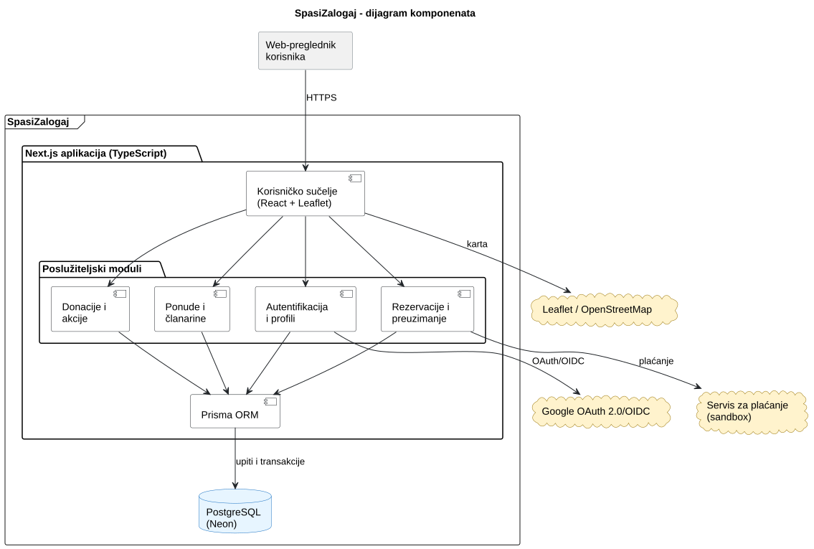
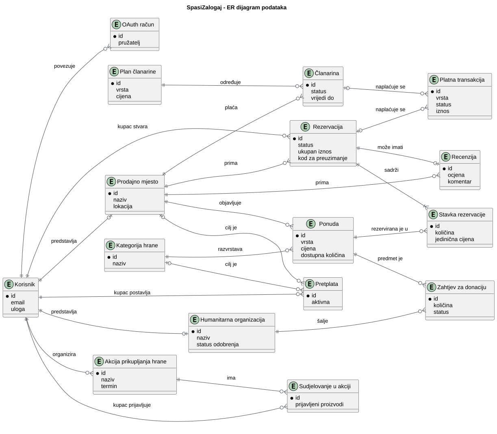
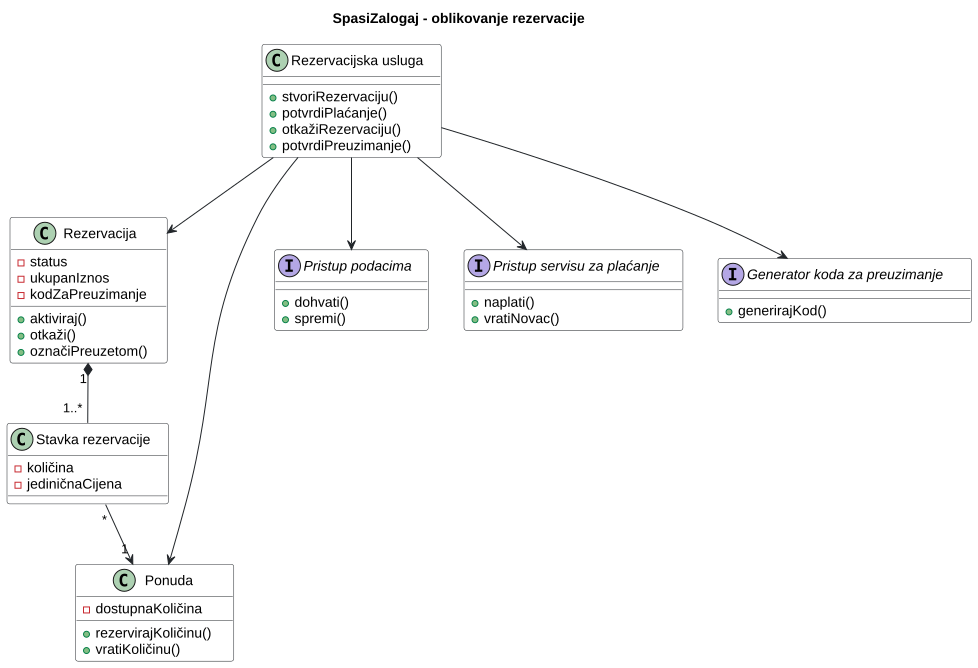
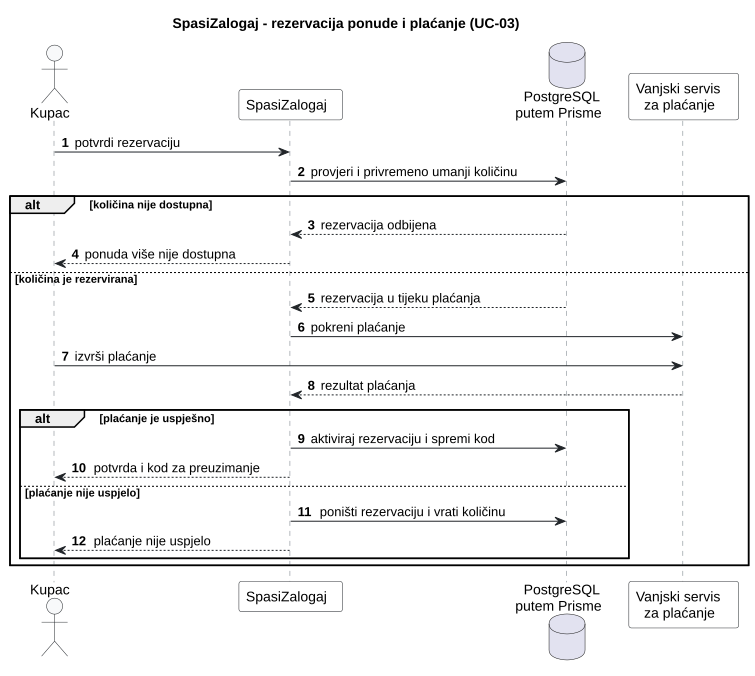
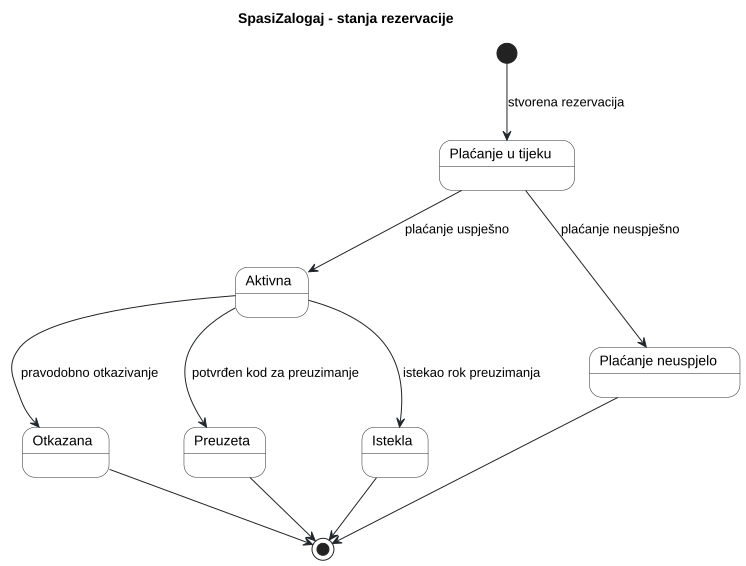

# 4. Arhitektura i oblikovanje

**Cilj:** Definirati arhitekturni stil, dekompoziciju programa na podsustave i module, organizaciju podataka te dinamičko ponašanje tijekom izvođenja. Arhitektura predstavlja temelj za implementaciju i ažurira se pri svakoj važnijoj promjeni projektnih odluka.

| Arhitekturni pogled | Ključno inženjersko pitanje | Primijenjeni model ili dijagram |
| :--- | :--- | :--- |
| **Strategija rješenja** | Koji stil i temeljne odluke određuju program? | Tablica odluka (odjeljak 4.1) |
| **Struktura podsustava** | Koji su glavni dijelovi i kako komuniciraju? | Dijagram komponenata |
| **Model podataka** | Kako su strukturirani trajni podaci programa? | Relacijski ER dijagram |
| **Struktura koda** | Kako su dodijeljene odgovornosti i ključne klase? | Reprezentativni dijagram razreda |
| **Dinamičko ponašanje** | Kako moduli surađuju pri obradi ključnih transakcija? | sekvencijski dijagram |
| **Stanja sustava** | Kako ključni domenski objekt mijenja svoja stanja? | Dijagram stanja |
| **Fizički razmještaj** | Na kojim se izvršnim čvorovima program izvodi? | Dijagram razmještaja (poglavlje 6) |

---

Za svaki UML dijagram čuvajte čitljivu sliku i PlantUML izvor, kako je opisano na stranici [Home](./Home.md). U dovršenoj stranici koristite vlastite projektne odluke i modele.

## 4.1 Ključne arhitekturne odluke

**Cilj:** Objasniti nekoliko arhitekturnih odluka koje najviše utječu na rješenje i navesti njihove projektno specifične razloge.

| Odluka | Razmatrana alternativa | Projektno specifično obrazloženje i kompromis |
| --- | --- | --- |
| Jedna full-stack aplikacija u Next.jsu i TypeScriptu (ADR-01) | Odvojeni frontend i backend ili više zasebno postavljenih usluga | Jedna aplikacija pojednostavljuje razvoj, povezivanje dijelova sustava i postavljanje na Vercel u okviru semestralnog projekta. Komponente i dalje imaju odvojene odgovornosti, ali se aplikacija postavlja kao cjelina pa kvar ili nova objava mogu utjecati na cijeli sustav. |
| Relacijska baza PostgreSQL na Neonu uz Prisma ORM (ADR-02) | Dokumentna, odnosno NoSQL baza | Korisnici, prodajna mjesta, ponude, rezervacije, plaćanja i donacije imaju jasne međusobne veze. Relacijski model i transakcije olakšavaju očuvanje dosljednosti količine i rezervacije, ali zahtijevaju migracije pri promjeni sheme i pažljivo modeliranje veza. |
| Auth.js i Google OAuth 2.0/OIDC za prijavu (ADR-03) | Vlastita prijava e-poštom i lozinkom | Google potvrđuje identitet korisnika, dok SpasiZalogaj u vlastitoj bazi čuva profil i ulogu. Sustav zato ne mora pohranjivati korisničke lozinke, ali prijava ovisi o dostupnosti Googlea i korisnik mora imati podržani račun. |

## 4.2 Gradivni blokovi i UML dijagram komponenata

**Cilj:** Prikazati logičku podjelu programa na komponente, njihova sučelja i vanjske integracije. Dijagram komponenata prikazuje logičku organizaciju, dok dijagram razmještaja prikazuje fizičko izvođenje. Ovaj prikaz ažurirajte kako sustav poprima konačan oblik.

**Slika 4.1. Dijagram komponenata sustava SpasiZalogaj**

**PlantUML izvor:** [izvor](./puml/4-1-spasizalogaj-system-CMP.puml)

| Komponenta | Odgovornost | Razlog za ovu granicu |
| --- | --- | --- |
| Web-sučelje | Prikazuje stranice za sve uloge, obrasce, kartu i QR kod; Leaflet u pregledniku učitava kartografske pločice OpenStreetMapa. | Korisnička interakcija odvojena je od poslovnih pravila i izravnog pristupa bazi. |
| Autentifikacija i profili | Provodi prijavu preko Googlea te upravlja korisničkim profilima i ulogama. | Vanjski identitet odvojen je od ovlasti kojima upravlja SpasiZalogaj. |
| Ponude i članarine | Upravlja ponudama, pretragom, dostupnošću i članarinama prodajnih mjesta. | Povezana pravila ponuda i aktivnog članstva ostaju u istom modulu. |
| Rezervacije i preuzimanje | Koordinira količinu, plaćanje, otkazivanje, kod i potvrdu preuzimanja. | Plaćanje i promjena dostupne količine moraju biti usklađeni zbog NF-05. |
| Donacije i akcije | Obrađuje zahtjeve za donacije, odluke prodajnih mjesta te akcije prikupljanja hrane i sudjelovanja. | Donacijski tijekovi imaju vlastite uloge i promjene stanja, ali ponovno koriste ponude i korisnike. |
| Prisma ORM i PostgreSQL | Prisma provodi upite i transakcije nad relacijskom bazom na Neonu. | Svi moduli koriste jedinstven model trajnih podataka i zajedničke transakcijske granice. |

Pravokutnici unutar sustava predstavljaju logičke odgovornosti jedne Next.js aplikacije, a ne zasebno postavljene mikrousluge. Google, servis za plaćanje i OpenStreetMap vanjske su ovisnosti. PostgreSQL baza pripada sustavu kao njegova trajna pohrana iako se fizički izvodi na upravljanoj platformi Neon.

## 4.3 Model podataka i oblikovanje razreda

**Cilj:** Objasniti važne informacije koje aplikacija pohranjuje i jedno reprezentativno područje oblikovanja na razini razreda. Model podataka i UML dijagram razreda odgovaraju na različita pitanja; jedno ne zamjenjuje drugo.

### 4.3.1 ER dijagram i model podataka

**Cilj:** Prikazati važne pohranjene entitete, njihove identifikatore i veze te dovoljno atributa za razumijevanje podataka aplikacije. ER dijagram odvojen je od reprezentativnog UML dijagrama razreda u nastavku.

**Slika 4.2. ER dijagram podataka sustava SpasiZalogaj**

**PlantUML izvor:** [izvor](./puml/4-2-spasizalogaj-data-ERD.puml)

**Planirana implementacija:** Prisma model bit će definiran u `prisma/schema.prisma` tijekom izrade prve funkcionalne verzije.

`Korisnik` sadrži zajednički identitet i jednu ulogu, dok `Prodajno mjesto` i `Humanitarna organizacija` sadrže podatke specifične za te uloge. Administrator nema zaseban profil nego se prepoznaje po ulozi korisnika. Vanjski OAuth račun povezuje Googleov identitet s korisnikom, bez pohrane lozinke.

`Ponuda` objedinjuje pojedinačni proizvod i paket iznenađenja pomoću vrste ponude; oznaka donacije određuje njezinu vidljivost humanitarnim organizacijama. Jedna rezervacija prema radnoj pretpostavci P-03 pripada jednom prodajnom mjestu, ali preko stavki može sadržavati više njegovih ponuda. Platna transakcija pripada točno jednoj rezervaciji ili članarini te čuva samo referencu vanjskog servisa, iznos i status, a ne podatke kartice (NF-03).

Za pretplatu vrijedi ograničenje da cilja točno jedno prodajno mjesto ili jednu kategoriju. Akciju prikupljanja hrane može organizirati korisnik s ulogom prodajnog mjesta ili humanitarne organizacije. Ta ograničenja, jedinstvenost koda za preuzimanje i dopuštene vrijednosti statusa bit će provedeni ograničenjima baze i poslužiteljskom validacijom.

### 4.3.2 Reprezentativni UML dijagram razreda

**Cilj:** Prije implementacije reprezentativnog dijela sustava modelirati i prikazati razrede ili sučelja potrebna za dodjelu odgovornosti, operacija i veza. Oblikovanje ažurirajte kada se te odluke promijene.

**Slika 4.3. Reprezentativni dijagram razreda za obradu rezervacije**

**PlantUML izvor:** [izvor](./puml/4-3-spasizalogaj-domain-CD.puml)

**Referenca na kod pri završnom pregledu:** bit će dopunjena poveznicama na implementaciju rezervacijskog modula nakon njegove izrade.

`Rezervacijska usluga` koordinira cijeli slučaj uporabe, ali pravila promjene stanja ostaju u `Rezervaciji`, a pravila dostupnosti količine u `Ponudi`. `Stavka rezervacije` pamti količinu i cijenu u trenutku kupnje kako naknadna promjena ponude ne bi promijenila već plaćenu rezervaciju.

Sučelja repozitorija odvajaju poslovna pravila od Prisme i baze, `PaymentGateway` od konkretnog servisa za plaćanje, a generator koda od načina stvaranja i sažimanja sigurnog jednokratnog koda. U TypeScript implementaciji odgovornosti mogu biti ostvarene razredima ili modulima s funkcijama; završni dijagram mora se uskladiti sa stvarnim kodom.

## 4.4 Ponašanje tijekom izvođenja

**Cilj:** Objasniti jednu važnu interakciju među dijelovima koji se izvode i životni ciklus jednog smislenog objekta. Odaberite primjere koji otkrivaju odluke ili neuspješne putove umjesto izrade dijagrama za svaku CRUD radnju.

### 4.4.1 Reprezentativni UML sekvencijski dijagram

**Cilj:** Prikazati redoslijed poruka za jedan reprezentativni scenarij i odgovore na važnu alternativu.

**Scenarij:** UC-03 – rezervacija ponude i plaćanje.

**Slika 4.4. Sekvencijski dijagram rezervacije ponude i plaćanja**

**PlantUML izvor:** [izvor](./puml/4-4-spasizalogaj-reservation-SD.puml)

Prije preusmjeravanja na servis za plaćanje sustav u jednoj transakciji provjerava i privremeno umanjuje dostupne količine te stvara rezervaciju u stanju `PAYMENT_PENDING`. Time dva istodobna zahtjeva ne mogu oba rezervirati posljednji komad (NF-05). Ako količina nije dostupna, transakcija se odbija prije naplate.

Vanjski servis obrađuje podatke kartice i SpasiZalogaju vraća samo potpisani rezultat. Uspješan povratni poziv aktivira rezervaciju i stvara jednokratni kod za preuzimanje. Neuspješno plaćanje ili istek pokušaja u transakciji vraća količine i završava privremenu rezervaciju. Povratni poziv mora biti idempotentan kako njegova ponovljena dostava ne bi dvaput promijenila stanje.

### 4.4.2 Reprezentativni UML dijagram stanja

**Cilj:** Prikazati važna stanja jednog domenskog objekta ili eksplicitno upravljanog načina rada sustava te događaje ili uvjete koji ih mijenjaju.

**Vlasnik stanja i razlog odabira:** vlasnik je `Rezervacija`, a trenutačno stanje pohranjuje se u atributu `status`. Rezervacija je odabrana jer njezini prijelazi istodobno utječu na plaćanje, dostupnu količinu i valjanost koda za preuzimanje.

**Slika 4.5. Dijagram stanja rezervacije**

**PlantUML izvor:** [izvor](./puml/4-5-spasizalogaj-reservation-SM.puml)

`Plaćanje u tijeku` interno je i privremeno stanje dok vanjski servis ne potvrdi ishod. Samo `Aktivna` rezervacija ima važeći kod i može prijeći u `Preuzeta`, `Otkazana` ili `Istekla`. Zahtjev za otkazivanje unutar posljednjeg sata ne mijenja stanje. Prema radnoj pretpostavci P-05 istekla, nepreuzeta rezervacija ne vraća količinu ni novac.

Status povrata novca vodi se u platnoj transakciji, a ne kao zasebno stanje rezervacije: rezervacija ostaje otkazana čak i ako servis za plaćanje zahtijeva ponovni pokušaj povrata. Nakon implementacije prijelazi će se ponovno usporediti sa stvarnim kodom i razriješenim otvorenim pitanjima P-04 i P-05.

## 4.5 Zapisi arhitekturnih odluka

**Cilj:** Sačuvati razloge i obrazložiti odabrane važne arhitekturne odluke kada tablica u odjelku 4.1 nije dovoljna za očuvanje konteksta, razmatranih alternativa i prihvaćenih kompromisa.

### ADR-01: Jedna modularna full-stack aplikacija u Next.jsu

| Polje | Zapis odluke |
| --- | --- |
| Kontekst i cilj | Tim tijekom jednog semestra mora izraditi korisnička sučelja za četiri uloge, poslužiteljsku poslovnu logiku, vanjske integracije i javno postavljanje aplikacije. |
| Kriteriji odluke | Mali trošak integracije i postavljanja, dijeljenje TypeScript tipova, jednostavno lokalno pokretanje te mogućnost da tim objasni granice odgovornosti. |
| Razmatrane alternative | Odvojeni frontend i backend s vlastitim postavljanjima; više zasebnih poslužiteljskih usluga; jedna full-stack aplikacija. |
| Odluka i obrazloženje | Koristiti jednu Next.js aplikaciju s logički odvojenim modulima i postavljanjem na Vercel. Time se smanjuje broj projekata i integracijskih točaka, ali se prihvaća da se aplikacija objavljuje kao cjelina i da kvar zajedničkog procesa može utjecati na više funkcionalnosti. |
| Status | Prihvaćeno 9. 11. 2026. |

### ADR-02: PostgreSQL na Neonu uz Prisma ORM

| Polje | Zapis odluke |
| --- | --- |
| Kontekst i cilj | Korisnici, profili, ponude, rezervacije, stavke, plaćanja, donacije i članarine imaju brojne veze, a promjena količine i rezervacije mora biti dosljedna. |
| Kriteriji odluke | Relacijski integritet, podrška za transakcije iz NF-05, upravljana baza dostupna postavljenoj aplikaciji te razumljiv i tipiziran pristup podacima iz TypeScripta. |
| Razmatrane alternative | Dokumentna/NoSQL baza; PostgreSQL uz ručno pisani SQL; PostgreSQL uz ORM. |
| Odluka i obrazloženje | Koristiti PostgreSQL na Neonu i Prisma ORM. Relacijski model i transakcije odgovaraju domeni, a Prisma daje shemu, migracije i tipizirane upite. Kompromisi su obavezne migracije pri promjeni sheme, pažnja na broj veza s bazom u poslužiteljskom okruženju i mogućnost da se za složen upit ipak upotrijebi SQL. |
| Status | Prihvaćeno 9. 11. 2026. |

### ADR-03: Auth.js i Google OAuth 2.0/OIDC

| Polje | Zapis odluke |
| --- | --- |
| Kontekst i cilj | Ograničenje C-01 zahtijeva vanjskog OAuth 2.0 pružatelja, a sustav mora prepoznati korisnika i sigurno primjenjivati vlastite uloge. |
| Kriteriji odluke | Bez pohrane lozinki, podrška za Googleovu prijavu, integracija sa sesijama u Next.jsu i mogućnost poslužiteljske provjere uloge i vlasništva nad podacima. |
| Razmatrane alternative | Vlastita prijava e-poštom i lozinkom; ručna implementacija OAuth/OIDC protokola; Auth.js s podržanim pružateljem identiteta. |
| Odluka i obrazloženje | Koristiti Auth.js s Googleom. Google potvrđuje identitet, a SpasiZalogaj u vlastitoj bazi povezuje identitet s profilom, ulogom i statusom. Time se smanjuje količina osjetljivog autentifikacijskog koda, uz ovisnost o dostupnosti Googlea i pretpostavku da korisnik ima podržani račun (AS-02). Podatak dobiven od pružatelja nije dovoljan za autorizaciju bez provjere u vlastitoj bazi. |
| Status | Prihvaćeno 9. 11. 2026. |

## 4.6 Zajednička pravila oblikovanja (engl. Cross-cutting concerns)

**Cilj:** Prepoznati i opisati globalna pravila i mehanizme oblikovanja koji se primjenjuju u više dijelova aplikacije, navesti gdje se planira primijeniti i ažurirati objašnjenje kako implementacija poprima konačan oblik. Uključite samo pravila koja su važna za ovaj projekt.

**Planirani mehanizmi (provjeriti i ažurirati tijekom implementacije):**

| Aspekt | Mehanizam | Pravilo | Mjesto primjene |
| --- | --- | --- | --- |
| Sigurnost | Autentifikacija i autorizacija | Auth.js potvrđuje sesiju, ali svaka zaštićena poslužiteljska radnja dodatno provjerava ulogu, status računa i vlasništvo nad traženim podatkom. Skrivanje gumba u sučelju nije zaštita (NF-02). | API rute, Server Actions i aplikacijski moduli prije čitanja ili promjene zaštićenih podataka. |
| Dosljednost rezervacije | PostgreSQL transakcija i uvjetovana promjena količine | Provjera količine, njezino privremeno umanjenje i stvaranje rezervacije izvode se atomski. Samo jedan od istodobnih zahtjeva može uzeti posljednji komad, a neuspjelo plaćanje količinu vraća (NF-05). | Rezervacijska usluga i Prisma transakcije; obrada povratnog poziva servisa za plaćanje. |
| Validacija podataka | Poslužiteljska provjera ulaza i poslovnih pravila | Svaki vanjski ulaz provjerava se prije uporabe: obavezna polja, pozitivne cijene i količine, redoslijed vremena, koordinate, dopušteni statusi te pripadnost ponude istom prodajnom mjestu. | Granica API-ja/Server Actions i odgovarajući aplikacijski modul; ograničenja baze kao dodatna zaštita. |
| Plaćanje | Vanjski servis i idempotentni povratni pozivi | SpasiZalogaj ne prima ni pohranjuje podatke kartice. Potpis povratnog poziva provjerava se, a ista referenca servisa ne smije dvaput aktivirati rezervaciju, vratiti količinu ili izvršiti povrat (NF-03, NF-05). | Rezervacijski modul, modul članarine i adapter odabranog servisa za plaćanje. |
| Kod za preuzimanje | Kriptografski slučajan kod i pohrana sažetka | Kod mora biti nepredvidiv i jedinstven; u bazi se čuva njegov sažetak. Pri uspješnoj potvrdi kod se uspoređuje na poslužitelju i odmah postaje nevažeći (NF-04). | Generator koda, rezervacijska usluga i radnja potvrde preuzimanja. |
| Vanjske ovisnosti | Kontrolirana obrada pogrešaka | Nedostupnost karte ne smije spriječiti tekstualni pregled ponuda, a pogreška Googlea, plaćanja ili e-pošte korisniku se prikazuje bez otkrivanja osjetljivih tehničkih detalja. | Web-sučelje i adapteri za OAuth, plaćanje, kartu i e-poštu. |

## 4.7 Arhitekturni rizici i tehnički dug

**Cilj:** Navesti stvarne tehničke ili domenske rizike i svjesno prihvaćene kompromise oblikovanja, njihove posljedice i način na koji ih tim obrađuje.

**Tehnički rizici i dug**

| Rizik ili kompromis | Posljedica | Odgovor na rizik  |
| --- | --- | --- |
| Jedna Next.js aplikacija postavlja se kao cjelina. | Pogreška zajedničke aplikacije ili neuspjela objava može utjecati na sve uloge i funkcionalnosti. | Kompromis je prihvaćen za semestralni projekt. Moduli se logički odvajaju i provjeravaju prije postavljanja, bez tvrdnje da sustav ima automatski failover. |
| Konačni servis za plaćanje još nije odabran između dostupnih testnih mogućnosti. | Različiti API-ji, vrste plaćanja i povratni pozivi mogu promijeniti detalje implementacije rezervacija i članarina. | Arhitektura koristi granicu `PaymentGateway`; tim mora potvrditi pružatelja i mogućnosti sandboxa prije implementacije plaćanja. |
| Istodobni zahtjevi i ponovljeni povratni pozivi mogu dvaput promijeniti količinu ili status plaćanja. | Moguća je dvostruka rezervacija, dvostruki povrat ili netočan status. | Planirane su transakcije, uvjetovane promjene količine, jedinstvena referenca plaćanja, idempotentna obrada i konkurentni test iz NF-05. |
| Sustav ovisi o Googleu, servisu za plaćanje, OpenStreetMapu i budućem pružatelju e-pošte. | Dio funkcionalnosti privremeno ne radi kada vanjska usluga nije dostupna. | Za kartu se zadržava tekstualni popis ponuda; ostale pogreške jasno se prikazuju i ne smiju ostaviti djelomične promjene u bazi. Za opseg kolegija ne uvodi se pričuvni pružatelj. |
| Nije odabrana trajna pohrana logotipa i fotografija ponuda. | Lokalni datotečni sustav Vercela nije prikladan za trajne korisničke datoteke pa bi slike mogle nestati ili biti nedostupne. | Prije implementacije F-003 i F-006 odabrati vanjsku objektnu pohranu; do tada u modelu ostaje samo URL slike. Slike se ne smiju spremati u lokalni datotečni sustav produkcije. |
| Poslužiteljsko izvođenje i veza s Neonom mogu imati hladna pokretanja ili ograničenje broja veza. | Pretraga i rezervacija mogu biti sporije ili povremeno neuspješne, posebno pod većim opterećenjem. | Koristiti način povezivanja koji preporučuje Neon za poslužiteljsko okruženje, indeksirati polja pretrage i mjeriti NF-06 na dogovorenom skupu podataka. |

**Poslovni ili domenski rizici, ako su značajni**

| Rizik | Posljedica | Odgovor na rizik |
| --- | --- | --- |
| Otvorena pitanja P-03 – P-06 mogu promijeniti pravila rezervacije, povrata, isteka i preuzimanja donacije. | Model podataka, prijelazi stanja ili korisnički tok mogu postati nedosljedni s konačnim dogovorom. | Trenutačni modeli izričito koriste zapisane radne pretpostavke. Nakon odgovora asistentice zajedno se ažuriraju zahtjevi, dijagrami i implementacija. |
| Prodajno mjesto unosi rok upotrebe, količinu i opis hrane. | Netočan ili zastario podatak može kupca navesti na pogrešnu odluku. | Poslužiteljska validacija odbija očito neispravne vrijednosti, a sučelje jasno prikazuje prodajno mjesto, vrijeme preuzimanja i rok; odgovornost za točnost podataka mora biti navedena u pravilima korištenja. |
| Kriteriji kojima administrator potvrđuje humanitarnu organizaciju nisu detaljno određeni. | Različiti administratori mogu profile odobravati nedosljedno. | Za prvu verziju čuvaju se status i razlog odluke; tim prije implementacije UC-07 treba dogovoriti obavezne podatke i kriterije pregleda. |

---

>**Završna provjera:** Usporedite dijagrame komponenata, podataka, razreda, sekvencijski dijagram i dijagram stanja s implementiranim kodom, ponašanjem aplikacije i stvarnim razmještajem. Ažurirajte zastarjele opise oblikovanja i objasnite svaku važnu razliku koja ostaje; poveznice na odgovarajući kod ili ispitivanja korisne su kada odgovaraju na konkretno pitanje.
